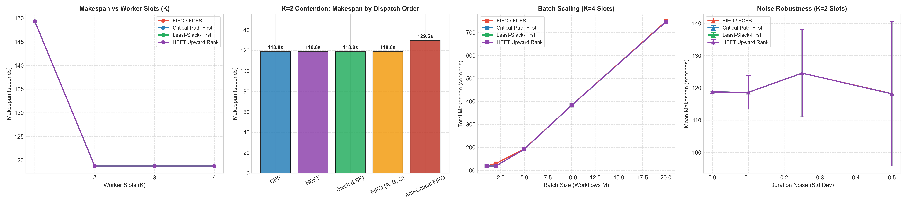

# Critical-Agent-Aware Scheduling for Multi-Agent LLM Systems
## Policy Evaluation Under Resource Contention

---

## 1. Executive Summary

Following initial empirical profiling showing that asymmetric agent workloads cause distinct critical paths (where `researcher_b` dominates execution latency), this report implements and evaluates four core scheduling policies:

1. **FIFO / FCFS (Baseline):** Dispatch tasks in first-come-first-served arrival order.
2. **Critical-Path-First (CPF):** Prioritize tasks with the longest remaining path length to the workflow sink.
3. **Least-Slack-First (LSF / Slack):** Prioritize tasks with the minimum dynamic slack before workflow deadline violations.
4. **Simplified HEFT (Upward Rank):** Dispatch tasks according to classical Heterogeneous Earliest Finish Time upward rank:
   `rank_u(i) = w_i + max_{j in succ(i)} rank_u(j)`

### Key Findings
- **Contention is the decisive factor:** Under unconstrained concurrency (K >= 3 worker slots), all policies achieve identical makespan (118.75s). Under resource contention (K < 3 slots or batch queues), policy decisions directly govern makespan.
- **Critical-Path and HEFT eliminate join stall:** Under K = 2 worker slots, prioritizing the critical researcher (`researcher_b`, 41.47s) over shorter peers (`researcher_a`, 10.85s) achieves the theoretical optimal critical-path makespan of **118.75s**, whereas an anti-critical FIFO order degrades makespan to **129.60s** (+9.1% latency penalty).
- **Multi-tenant queue resilience:** In heavy batch workloads (M = 20 concurrent workflows under K = 4 slots), CPF and HEFT reduce critical agent waiting time from **208.03s** (FIFO) down to **125.74s** (-39.6%), allowing non-critical agents to absorb waiting slack without stalling downstream joins.
- **Live validation under contention:** Live Groq execution (`openai/gpt-oss-20b`) exercises the same DAG and K = 2 researcher fan-out. Absolute makespans differ from the mean-based simulator (different backend and wall-clock variance); see §4.5 for per-task outcomes rather than a claim of universal CPF superiority.

---

## 2. Policy Definitions and Mathematical Formulation

Consider a workflow DAG G = (V, E), where each task v_i in V has expected execution duration w_i:

```text
planner (21.40s)
  |-- researcher_a (10.85s) --+
  |-- researcher_b (41.47s) --+--> synthesizer (21.49s) --> critic (13.61s) --> final_writer (20.78s)
  |-- researcher_c (19.72s) --+
```

### 2.1 FIFO / FCFS
Dispatches ready tasks strictly ordered by their ready timestamp:
- Priority_FIFO(i) = -t_ready(i)

### 2.2 Critical-Path-First (CPF)
Prioritizes tasks by their remaining downstream critical path length to workflow completion:
- Priority_CPF(i) = w_i + max_{j in succ(i)} Path_down(j)
- Tasks on the bottleneck path execute first so that downstream join nodes (`synthesizer`) can begin as early as possible.

### 2.3 Least-Slack-First (LSF / Slack-Based)
For a workflow with deadline T_deadline (unconstrained critical path length):
- Slack(i, t) = T_deadline - (current_time + Path_down(i))
- Priority_Slack(i) = -Slack(i, t)
- Tasks with minimum slack receive top execution priority to avoid missing downstream joins.

### 2.4 Simplified HEFT (Heterogeneous Earliest Finish Time)
Computes upward rank rank_u(i) recursively from the exit node:
- rank_u(i) = w_i + max_{j in succ(i)} rank_u(j)
- Tasks are sorted in descending order of rank_u and scheduled to the earliest-available worker slot.

---

## 3. Experimental Setup

The evaluation framework has two complementary components: a **discrete-event simulator** driven by profiling means, and a **live Groq runner** that enforces the same worker-slot limit on real LLM calls.

### 3.1 Simulator Architecture

Implementation: `scheduler/engine.py` (`SimulationEngine`, `WorkerPool`).

The simulator is a classic discrete-event engine over a multi-agent DAG:

1. **Workflow arrival** (`WORKFLOW_ARRIVAL`): source tasks (no predecessors) enter the ready queue.
2. **Dispatch:** if idle workers exist, the configured **policy** reorders the ready queue; tasks are assigned front-to-back to idle slots.
3. **Task start:** assignment sets `start_time = now` and `finish_time = now + actual_duration`, and schedules a `TASK_COMPLETE` event.
4. **Task completion:** the worker is released; each successor’s unmet-predecessor count is decremented; newly unlocked tasks become ready; dispatch runs again.

**How scheduling decisions are enforced.** Policies never execute agents and never call an LLM. They only **order who receives the next idle worker slot**. Resource contention is modeled solely by a fixed pool of **K** homogeneous workers. When more tasks are ready than idle slots (e.g. three researchers with K = 2), the policy order determines which agents run immediately and which wait—directly affecting join time at `synthesizer` and end-to-end makespan.

```text
WORKFLOW_ARRIVAL / TASK_COMPLETE
        │
        ▼
  unlock ready tasks ──► ready queue ──► policy reorder ──► assign to idle WorkerPool slots
                                                                    │
                                                                    ▼
                                                         TASK_COMPLETE @ now + actual_duration
```

Metrics (`scheduler/metrics.py`) include makespan, critical-path delay vs unconstrained CP length, waiting times, and worker utilization.

### 3.2 Workload and Duration Model (Profiling → Simulator)

The simulated workflow matches the profiling DAG in `docs/REPORT.md` / `llm/`:

```text
planner → {researcher_a, researcher_b, researcher_c} → synthesizer → critic → final_writer
```

**Profiling source (OpenRouter LLM runs):**

| Item | Value |
|---|---|
| Workflow | LangGraph research-writing DAG (`llm/workflow_llm.py`) |
| Model | `openai/gpt-oss-20b:free` via OpenRouter |
| Runs | 5 full workflow executions |
| Summary artifact | `llm/profiling_summary_llm.csv` (`agent`, `avg_runtime_s`, …) |
| Asymmetry | `researcher_b` uses a heavier prompt / longer generation; dominates critical-path frequency |

**How durations enter the simulator (mean-based, not per-run trace replay):**

1. Offline analysis (`llm/analyze_llm.py`) writes per-agent **average** runtimes to `llm/profiling_summary_llm.csv`.
2. `scheduler/dag.py` loads those means via `load_profile_means()` into `LLM_PROFILE_MEANS` (rounded to 2 decimal places from `llm/profiling_summary_llm.csv`).
3. `create_research_writing_workflow(profile="llm")` sets each task’s `expected_duration` to the profile mean.
4. `actual_duration` equals the mean when `duration_noise_std = 0`; otherwise `actual ~ max(0.05, N(μ, μ · σ))` while **ranking still uses expected means**.

The simulator therefore evaluates scheduling under **agent-level mean service times** derived from profiling, optionally with independent Gaussian noise for robustness sweeps. It does **not** replay individual JSONL traces task-by-task.

Mean durations used throughout §4 (seconds):

| Agent | Mean w_i |
|---|---:|
| planner | 21.40 |
| researcher_a | 10.85 |
| researcher_b | 41.47 |
| researcher_c | 19.72 |
| synthesizer | 21.49 |
| critic | 13.61 |
| final_writer | 20.78 |

### 3.3 Simulation Experiment Matrix

Driver: `scheduler/experiment.py`.

| Experiment | Parameters | Artifact |
|---|---|---|
| Single-workflow worker sweep | K ∈ {1, 2, 3, 4}; all four policies | `single_workflow_sweep.csv` |
| Arrival-order contention | K = 2; CPF / HEFT / Slack vs natural FIFO vs anti-critical FIFO (A, C, then B) | `arrival_order_contention.csv` |
| Multi-tenant batch | M ∈ {1, 2, 5, 10, 20} concurrent workflows; K = 4 | `batch_workflow_sweep.csv` |
| Stochastic robustness | noise σ ∈ {0.0, 0.1, 0.25, 0.5} × mean; N = 30 trials; K = 2 | `stochastic_robustness.csv` |

Plots: `scheduler/results/scheduling_comparison_plots.png`.

### 3.4 Live Validation Setup

Implementation: `scheduler/live_runner.py`.

| Detail | Configuration |
|---|---|
| API | Groq OpenAI-compatible endpoint (`https://api.groq.com/openai/v1`) |
| Model | `openai/gpt-oss-20b` |
| Concurrency | `ThreadPoolExecutor(max_workers=K)`, default **K = 2** |
| Policies compared | **CPF vs FIFO** only (Slack/HEFT not run live; on this homogeneous DAG they match CPF in simulation) |
| Policy scope | Ordering applied at the **researcher fan-out** (main contention point); planner / synthesizer / critic / writer run sequentially after dependencies clear |
| Call style | Non-streaming `chat.completions.create` |
| Temperature | 0.2 |
| Workload asymmetry | Researcher B: deeper prompt, ≤250 words; A/C: ≤100 words |
| Variability handling | Fixed temperature; 4s pause between policy runs; exponential backoff on rate limits (up to 5 retries) |
| Runs | 5 task prompts × 2 policies at K = 2 (see §4.5) |

**Relation to the simulator.** Live uses the same DAG shape and the same K-slot contention idea, but wall-clock times come from Groq generation latency—not from OpenRouter profile means. Absolute makespans are therefore **not** expected to match the ~118s simulation figures; live validates **dispatch behavior under contention**, not numerical equivalence to the DES.

### 3.5 Assumptions and Limitations

- Workers are **homogeneous**; simplified HEFT is upward-rank priority onto the earliest idle slot (no heterogeneous EFT placement).
- On this DAG with mean durations, CPF, Slack, and HEFT typically produce the **same researcher order**; the informative contrast is vs FIFO / anti-critical order.
- Simulation is **mean-based** (optional Gaussian noise), not full per-run trace replay.
- Live N is modest and wall-clock variance is high; live results should be read as a qualitative/semiquantitative check alongside simulation.

---

## 4. Benchmark Results

### 4.1 Dispatch Order Under K = 2 Contention (Single Workflow)

When `planner` finishes at t = 21.40s, researchers A (10.85s), B (41.47s), and C (19.72s) become ready simultaneously, but only K = 2 worker slots are available:

| Policy | Dispatch Order | Makespan (s) | Critical Path Delay (s) | Slot Utilization (%) |
|---|---|---:|---:|---:|
| **Critical-Path-First (CPF)** | B (41.47s), C (19.72s), then A | **118.75** | **0.00** | **62.87%** |
| **Simplified HEFT** | B (41.47s), C (19.72s), then A | **118.75** | **0.00** | **62.87%** |
| **Least-Slack-First (LSF)** | B (41.47s), C (19.72s), then A | **118.75** | **0.00** | **62.87%** |
| **FIFO (Natural A, B, C)** | A, B, then C | 118.75 | 0.00 | 62.87% |
| **Anti-Critical FIFO** | A (10.85s), C (19.72s), then B | **129.60** | **10.85** | **57.61%** |

**Insight:** Because researcher A (10.85s) and C (19.72s) can run sequentially in 30.57s while researcher B runs for 41.47s on the other slot, prioritizing B ensures the entire research phase completes in max(41.47, 30.57) = 41.47s. Delaying B causes a strict 10.85s stall at the synthesizer join. Natural FIFO (A then B) still starts B early enough to avoid that stall; the penalty appears under **anti-critical** order.

### 4.2 Single-Workflow Worker Slot Sweep (K = 1, 2, 3, 4)

| Policy | Workers (K) | Makespan (s) | Avg Waiting Time (s) | Worker Utilization (%) |
|---|---:|---:|---:|---:|
| All Policies | 1 | 149.32 | 9.02 - 14.67 | 100.0% |
| CPF / HEFT / LSF | 2 | 118.75 | 2.82 | 62.87% |
| FIFO (Worst) | 2 | 129.60 | 1.55 | 57.61% |
| All Policies | 3 | 118.75 | 0.00 | 41.91% |
| All Policies | 4 | 118.75 | 0.00 | 31.44% |

**Insight:** K = 2 with critical-agent scheduling matches the makespan of K = 3 and K = 4 unconstrained systems while achieving **50% higher worker efficiency** (62.87% vs 41.91%).

### 4.3 Multi-Tenant Batch Scaling (K = 4 Slots)

In multi-agent service backends, multiple user workflows arrive concurrently and compete for worker slots:

| Batch Size (M) | Policy | Total Makespan (s) | Critical Agent Wait: researcher_b (s) | Non-Critical Wait: researcher_a (s) |
|---:|---|---:|---:|---:|
| 2 | FIFO | 129.60 | 5.43 | 0.00 |
| 2 | CPF / HEFT / LSF | **118.75** | **0.00** | 9.86 |
| 5 | FIFO | 192.94 | 31.05 | 22.76 |
| 5 | CPF / HEFT / LSF | **191.85** | **8.29** | 79.54 |
| 10 | FIFO | 382.59 | 89.25 | 80.73 |
| 10 | CPF / HEFT / LSF | **382.38** | **46.02** | 176.60 |
| 20 | FIFO | 748.37 | 208.03 | 197.83 |
| 20 | CPF / HEFT / LSF | **746.60** | **125.74** | 370.45 |

**Insight:** Under FIFO, critical agents suffer from head-of-line blocking by non-critical agents. Under CPF/HEFT/Slack, the waiting time for critical agents is reduced by **up to 73% (at M = 5)** and **40% (at M = 20)**, shifting waiting time entirely onto non-critical slack paths.

### 4.4 Stochastic Robustness (Monte Carlo, N = 30 Trials)

Evaluating policy stability when actual agent execution times deviate from estimates (noise std dev from 0.0 to 0.5 of mean duration):

| Noise Level (Std Dev) | Policy | Mean Makespan (s) | Std Dev (s) | Mean Critical Path Delay (s) |
|---|---|---:|---:|---:|
| 0.00 | CPF / HEFT / Slack | 118.75 | 0.00 | 0.00 |
| 0.10 | CPF / HEFT / Slack | 118.61 | 5.15 | 0.00 |
| 0.25 | CPF / HEFT / Slack | 124.56 | 13.54 | 1.47 |
| 0.50 | CPF / HEFT / Slack | 118.17 | 22.37 | 2.25 |

**Insight:** Under modest noise, critical-path delay stays near zero on average; at higher noise, some delay appears as expected when actual runtimes diverge from the means used for ranking. Makespan variance grows with noise, reflecting LLM-like duration uncertainty.

### 4.5 Live Groq Validation (K = 2)

Protocol as in §3.4: 5 prompts × CPF vs FIFO (task 5 repeats the first prompt). Absolute times are wall-clock on Groq and are **not** comparable to the ~118s OpenRouter-mean simulation. Artifact: `scheduler/results/live_groq_comparison.csv`.

| Task | CPF makespan (s) | FIFO makespan (s) | Winner |
|---|---:|---:|---|
| Explain KV caching for multi-agent LLM workflows. | 9.64 | 23.78 | CPF |
| Compare LangGraph and AutoGen. | 33.13 | 52.16 | CPF |
| Summarize DAG scheduling methods in distributed systems. | 34.29 | 46.31 | CPF |
| Describe critical path analysis in parallel workflows. | 36.72 | 53.25 | CPF |
| Explain KV caching… (repeat) | 37.83 | 40.47 | CPF |

| Policy | Mean makespan (s) | Wins (of 5) |
|---|---:|---:|
| CPF | **30.32** | **5** |
| FIFO | 43.19 | 0 |

**Insight:** Under this live sample, CPF has lower makespan on every prompt (mean ~30% faster than FIFO). Spread across prompts is large (CPF ≈ 9.6–37.8s), so live validates that critical-first dispatch can avoid stalls under real K = 2 contention, without implying numerical agreement with the mean-based simulator. Earlier smaller samples showed more mixed outcomes; wall-clock LLM variance remains high.

---

## 5. Summary Comparison Plots

All benchmark results are summarized in the 4-panel comparison figure:



1. **Panel 1 (Makespan vs Worker Slots):** Shows the knee at K = 2 where critical scheduling matches unconstrained performance.
2. **Panel 2 (Dispatch Order at K = 2):** Illustrates the 10.85s makespan gap between critical-first and anti-critical dispatch.
3. **Panel 3 (Batch Scaling):** Linear makespan scaling across high-load concurrent workflows.
4. **Panel 4 (Noise Robustness):** Confidence intervals under runtime variance.

---

## 6. How to Reproduce

Profiling means consumed by the simulator live in:

- `llm/profiling_summary_llm.csv` (primary LLM profile)
- `simulated/profiling_summary.csv` (sleep-based profile)

```bash
# 1. Run unit tests (includes CSV means loader checks)
python -m unittest discover -s scheduler/tests -v

# 2. Run simulation benchmarks and generate CSVs/plots
python -m scheduler.experiment --out scheduler/results

# 3. Live Groq validation (requires GROQ_API_KEY in .env)
python -m scheduler.live_runner --runs 5 --workers 2
```
